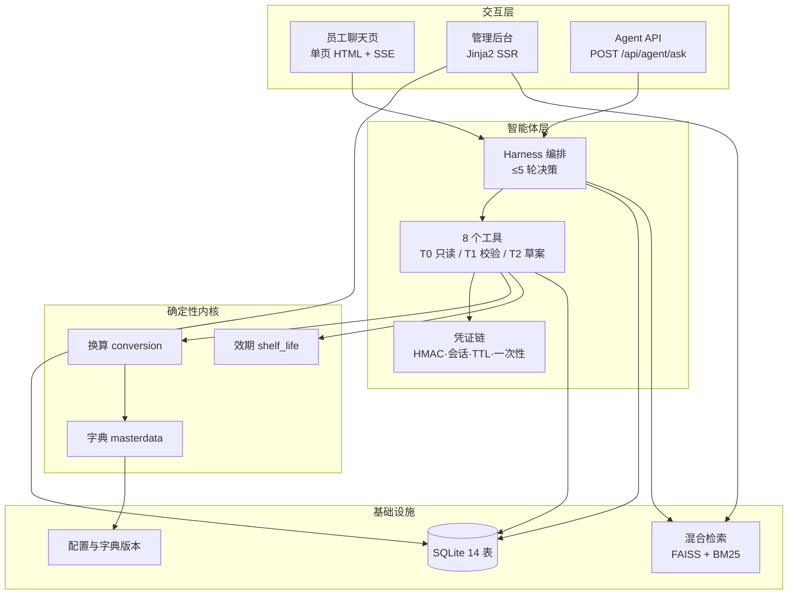

# 备料助手（Prep Assistant）


给中央厨房备料段的协同系统：把门店报的**成品份数**按**批次实测出成率**换算成**原料公斤数**，把短保批次的**解冻状态与剩余效期**变成可查状态，把跨岗交接变成「**对方确认接手才算完成**」的待办。

一句话概括设计取向：**模型负责串流程，数字永远由确定性规则算，写操作永远等人点**。

> **当前状态：可运行、可测试、未上线。**
> 四层系统（制度 RAG → 工具层 → 编排 Harness → 管理后台）均已实现，`pytest` 62 条全绿。
> 按决策记录 B6「本阶段不做现场上线」，仍缺确认卡片页与回写 outbox（见 [路线图](#路线图)），请勿用于生产。

## 这个系统不做什么

这几条是食安红线，**任何授权下都不开放**，也不提供关闭开关（详见 [`docs/decision-log.md`](docs/decision-log.md)）：

- 不自主下单、不延长效期、不替换配方
- 不由模型修改效期或放行食品，异常批次只能由质量人员隔离
- 不覆盖原记录——所有更正只能追加
- 不由模型替员工确认、接手、回写、隔离——这四类动作**根本不注册为工具**

## 能力矩阵

状态只有三种：**已实现**（有测试）/ **规格**（有设计无代码）/ **未做**。

| 能力 | 状态 | 入口 | 证据 |
|---|---|---|---|
| 制度问答（混合检索 + 引用来源） | 已实现 | `POST /api/chat`（SSE） | `tests/test_chat_api.py`、`test_rag_modules.py` |
| 份数→公斤换算（六要素、向上取整 0.1kg） | 已实现 | 工具 `validate_material_need` | `core/conversion.py`、`test_core.py` |
| 短保效期三级判定（ok / warn / block） | 已实现 | 工具 `check_shelf_life` | `core/shelf_life.py` |
| 批次台账查询（缺字段返回 null 而非默认值） | 已实现 | 工具 `get_batch_status` | `infra/agent_store.py` |
| 数据新鲜度与未接入系统说明 | 已实现 | 工具 `get_sync_status` | `test_agent_tools.py` |
| 备料建议草案（强制中断等确认） | 已实现 | 工具 `create_suggestion_draft` | `agents/harness.py`、`test_agent_harness.py` |
| 交接待办（对方确认才闭环） | 已实现 | 工具 `create_handover_task` | `test_agent_tools.py` |
| 批次异常上报（不改批次状态） | 已实现 | 工具 `report_batch_anomaly` | `test_agent_tools.py` |
| 凭证链四道闸（HMAC/会话/TTL/一次性） | 已实现 | 工具层内部 | `agents/tools/tokens.py` |
| 管理后台（知识库 / 提示词 / 审计） | 已实现 | `/admin/*` | `tests/test_admin.py` |
| 确认卡片页面（`/prep/drafts/{id}`） | 未做 | — | 接口已就绪，页面缺失 |
| 回写 outbox（仅执行结果字段） | 规格 | — | `core/writeback.py` |
| T3 四个办公动作页面 | 未做 | — | 按设计不进模型上下文 |

## 架构



| 层 | 职责 | 关键模块 | 为什么单独成层 |
|---|---|---|---|
| 交互层 | 对话、后台运营、审计查看 | `static/chat.html`、`templates/*.html` | 前端只渲染 `tool_result` 里的数值，不接收模型自报的数字 |
| 智能体层 | 决策、调工具、编排轮次 | `agents/harness.py`、`tools/*` | 护栏必须可审计，所以不引入框架的状态机黑盒 |
| 确定性内核 | 换算、效期、字典 | `core/*.py` | 纯函数、不读时钟、不调模型，可逐位重放 |
| 基础设施 | 存储、检索、版本 | `infra/*`、`data/*.db` | 字典与提示词版本只增不改，保证历史可重建 |

### 三条关键设计

**① 数值链路禁止模型参与。**
`49.0 kg` 来自 `份数 × 标准份分母 ÷ 1000 ÷ 实测出成率` 的确定性计算，向上取整到 0.1kg。模型只负责把工具返回值原样转述；改写一个数字，服务端会以 `PROVENANCE_MISMATCH` 拒绝建单。

**② 写操作靠凭证链，不靠提示词。**
模型调 `create_suggestion_draft` 时必须携带本会话签发的 `run_id` 与 `risk_id`，四道闸依次校验：HMAC 签名 → 会话归属 → 10 分钟 TTL → 一次性消费，并用 `params_hash` 逐位比对参数。提示词铁律只是第三层防御，真正拦住"跳过校验"的是服务端。

**③ 每一步都留痕，事后可重建。**
每轮模型决策与每次工具执行写入 `agent_round_logs`（工具名 / 参数 / 耗时 / 结果摘要），配合字典版本与提示词版本，能回答"这个数是谁在什么时候、按哪版规则算的"。

## 安装

```bash
python -m venv .venv
source .venv/Scripts/activate     # Windows Git Bash；PowerShell 用 .venv\Scripts\Activate.ps1
pip install -r requirements.txt
pip install -e .
```

## 运行

```bash
# 查看命令行入口与当前规格摘要
python -m prep_assistant.main --help

# 起服务：聊天页 http://127.0.0.1:8000/ ，管理后台 /admin/login
python -m prep_assistant.main serve

# 智能体工具层演示（不需要 API 密钥，直接看四道闸怎么拦人）
python examples/agent_demo.py

# 跑测试
pytest -q
```

## 文档

| 文档 | 内容 |
|---|---|
| `docs/备料助手-一页纸需求清单.md` | 需求基线（v1.0，11 项决策冻结） |
| `docs/decision-log.md` | 决策记录与依据（B1–B6） |
| `docs/design.md` | 架构分层与关键约束 |
| `docs/agent-tooling-design.md` | 智能体工具层：8 个工具、凭证链、系统提示词铁律 |
| `docs/api.md` | 接口说明（阶段 2/3/4 已实现） |
| `docs/discovery-report.md` | 业务发现报告（36 条访谈事实） |
| `docs/prd-agent-assistant-capability-a.md` | 早期 PRD（**仅作参考**，部分结论已被决策推翻） |

## 目录结构

```
.
├── src/prep_assistant/   # 源码：main 入口、core 业务、utils 工具
├── tests/                # 测试，结构与 src 对应
├── docs/                 # 需求、设计、接口、访谈材料
├── examples/             # 可运行示例
├── scripts/              # 构建与部署脚本
├── config/               # 非机密默认配置
├── data/                 # 样例数据（小文件）
└── .github/              # CI、Issue / PR 模板
```

## 许可证

MIT，见 `LICENSE`。若不打算开源，删除该文件并在 `README` 注明「内部项目，保留所有权利」。
