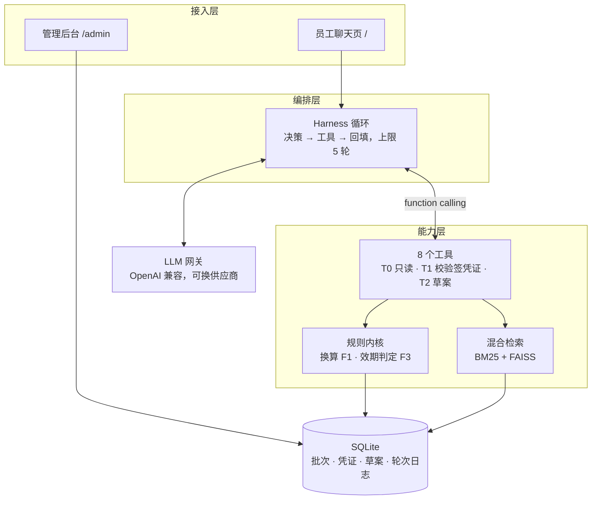

# 备料助手（Prep Assistant）

给中央厨房备料段的协同系统：把门店报的**成品份数**按**批次出成率**换算成**原料公斤数**，把短保批次的**解冻状态与剩余效期**变成可查状态，把跨岗交接变成「**对方确认接手才算完成**」的待办。

> **当前状态：阶段 1–4b 已实现，可在本地完整运行。**
> 62 条自动化测试全绿；智能体链路（工具调用 → 凭证校验 → 建单前强制中断）已跑通；
> 换算与效期判定为纯规则内核，不经过模型。
>
> **尚未上线**：按决策 B6「本阶段不做现场上线」，当前定位是试点就绪而非生产可用。
> 已知待办：草案确认卡片页面、回写 outbox。逐项状态见 `docs/go-live-checklist.md`。

## 这个系统不做什么

这几条是食安红线，任何授权下都不开放（详见 `docs/decision-log.md`）：

- 不自主下单、不延长效期、不替换配方
- 不由模型修改效期或放行食品，异常批次只能由质量人员隔离
- 不覆盖原记录——所有更正只能追加

## 架构



读图要点：模型只活在 `Harness ↔ LLM` 这条文字链路上。凡是数值，都由工具层调用规则内核算出后回填，模型只负责复述，**不参与任何乘除、取整或单位换算**。

四个人类专属动作——确认草案、接手交接、回写、隔离批次——**不在工具清单里**（图中无连线），模型无法调用，只能引导用户本人操作。

## 安装

```bash
python -m venv .venv
source .venv/Scripts/activate     # Windows Git Bash；PowerShell 用 .venv\Scripts\Activate.ps1
pip install -r requirements.txt
pip install -e .
```

## 运行

```bash
# 查看命令行入口与当前规格摘要
python -m prep_assistant.main --help

# 起服务：聊天页 http://127.0.0.1:8000/ ，管理后台 /admin/login
python -m prep_assistant.main serve

# 智能体工具层演示（不需要 API 密钥，直接看四道闸怎么拦人）
python examples/agent_demo.py

# 跑测试
pytest -q
```

## 验证（每条结论都能当场复现）

不想读代码就验货，按下面四条走，全部本地执行：

| 要证明什么 | 命令 | 预期看到 |
|---|---|---|
| **护栏真的拦得住** | `python examples/agent_demo.py` | 10 步撞闸：伪造凭证、把 49.0 改成 45、跨会话复用、block 批次建单等逐条被拒并给出 `recover_hint`；最后演示建单前强制中断。**不需要 API 密钥** |
| **代码是绿的** | `pytest -q` | `62 passed`，覆盖换算内核、效期判定、RAG 模块、聊天/管理接口、8 个工具、Harness 循环 |
| **环境可演示** | `python scripts/preflight.py` | 环境自检：依赖、密钥、批次数据、知识来源逐项列出，退出码 0 表示可完整演示 |
| **红线可被审计** | 打开 `docs/go-live-checklist.md` | 25 项上线检查（负责人 / 验证方法 / 通过标准）+ 7 个已确认阻断项 |

评测集：`eval/cases.json` 共 30 条——制度 10（含 3 条「知识库中未找到」陷阱）、工具调用 10（标注期望工具与顺序）、违规意图 5、多轮上下文 5。执行器尚未落地，当前用于人工验收与回归对照。

## 文档

| 文档 | 内容 |
|---|---|
| `docs/备料助手-一页纸需求清单.md` | 需求基线（v1.0，11 项决策冻结） |
| `docs/decision-log.md` | 决策记录与依据（B1–B6） |
| `docs/architecture.md` | 四层架构、数据流与部署形态 |
| `docs/design.md` | 模块设计与关键约束 |
| `docs/agent-tooling-design.md` | 智能体工具层：8 个工具、凭证链、系统提示词铁律 |
| `docs/agent-loop.md` | Harness 执行循环与三条典型对话轨迹 |
| `docs/api.md` | 接口说明（阶段 2/3/4 已实现） |
| `docs/discovery-report.md` | 业务发现报告（36 条访谈事实） |
| `docs/go-live-checklist.md` | 上线前 25 项检查（负责人 / 验证方法 / 通过标准）与 7 个阻断项 |
| `docs/demo-script.md` | 12 分钟演示脚本：六幕节奏、离线版、翻车预案 |
| `docs/flow-annotation-report.html` | 备料流程图标注报告，浏览器直接打开 |
| `docs/prd-agent-assistant-capability-a.md` | 早期 PRD（**仅作参考**，部分结论已被决策推翻） |

## 目录结构

```
.
├── src/prep_assistant/   # 源码：agents（RAG / 工具 / Harness）、api、core、infra、utils
├── tests/                # 62 条自动化测试，结构与 src 对应
├── eval/                 # 评测用例集（30 条：制度 / 工具 / 违规 / 多轮）
├── docs/                 # 需求、决策、架构、工具设计、上线与演示材料
├── examples/             # 可运行示例，含离线闸门演示
├── scripts/              # 构建 / 部署脚本、演示前自检
├── static/ · templates/  # 员工聊天页与管理后台页面
├── config/               # 非机密配置与主数据字典
├── data/                 # 样例知识与本地 SQLite（不入库）
└── .github/              # CI、Issue / PR 模板
```

## 持续集成

`.github/workflows/ci.yml` 在 push 与 PR 时执行两步，任一失败即阻断合并：

```bash
ruff check .     # 静态检查（E/F/I/UP/B，行宽 100）
pytest -q        # 62 条测试
```
